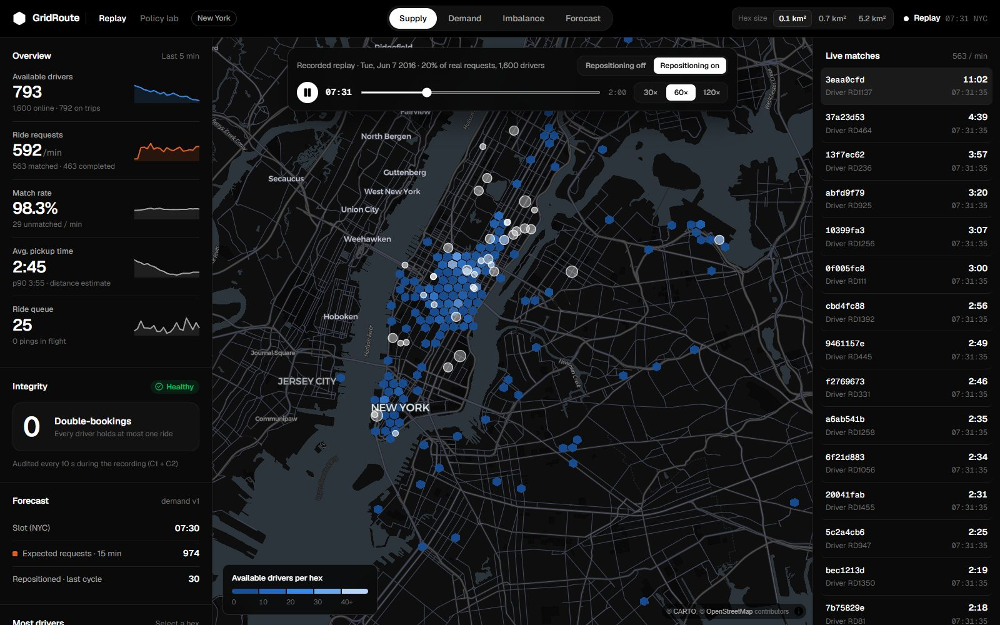
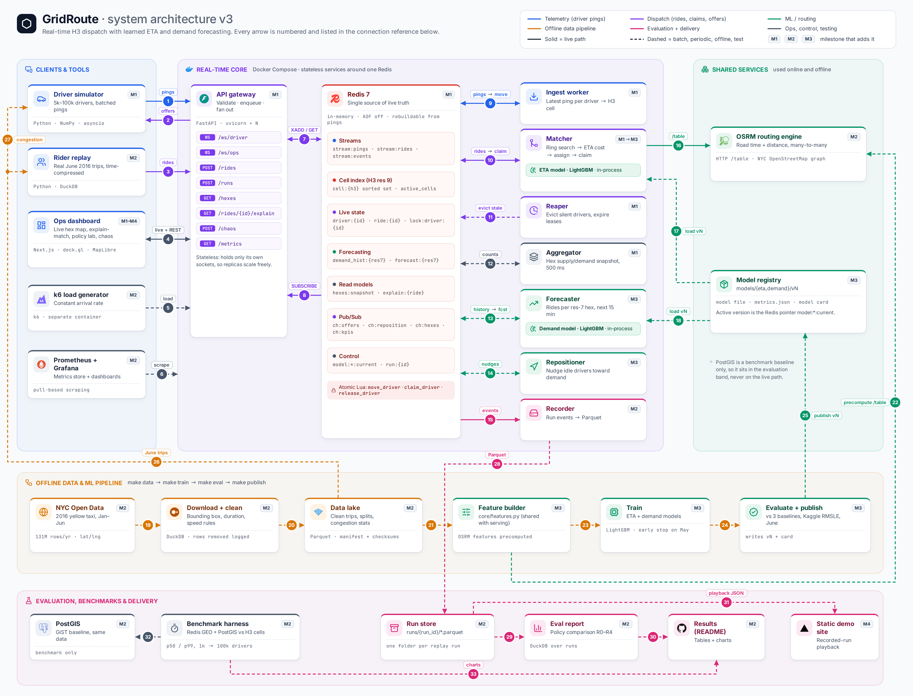
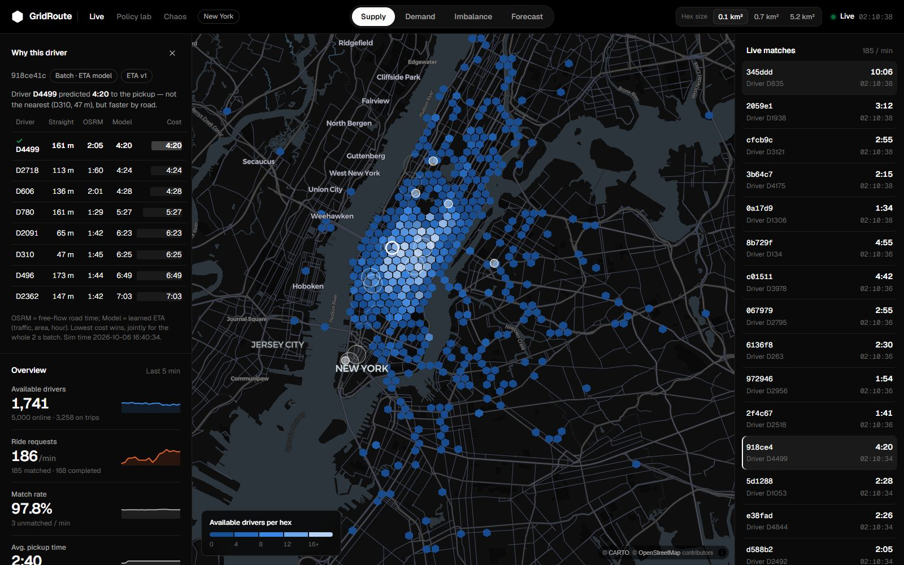
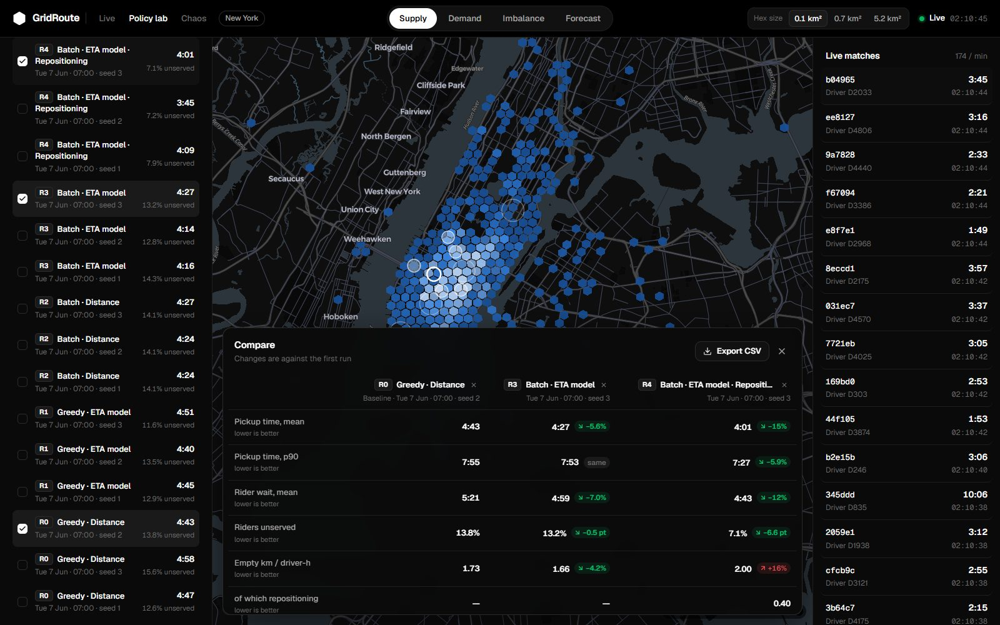

# GridRoute

**Real-time ride dispatch on Uber's H3 hex grid, with learned ETAs and demand forecasting, measured on
67 million real New York taxi trips.**

**[▶ Try the live demo](https://gridroute.vercel.app)**: a recorded morning rush hour, playable in the browser
with no install. Switch repositioning off and on and watch unserved riders drop.



GridRoute is a working dispatch engine, not a notebook:

- Simulated drivers stream GPS pings into an H3-indexed Redis.
- Riders are matched in 2-second batches by the Hungarian algorithm on a learned road-time ETA.
- Every claim on a driver is one atomic Lua script, so no driver is ever double-booked.
- A demand model forecasts the next 15 minutes per area, and a repositioner moves idle drivers toward the
  shortfall before riders appear.
- The results come from replaying real 2016 demand through the live system, three seeds per configuration,
  one change per row.

## Results

Tuesday 7 June 2016, 07:00–09:00, 20% of real requests, 1,600 drivers. The ETA model has never seen June.
Pickup time is the *true* simulated drive time (road time × measured June congestion).

| Row | Matching | Cost | Repositioning | Pickup mean | Riders unserved | Empty km / driver-h |
|---|---|---|---|---|---|---|
| R0 | Greedy | Straight-line distance | Off | 4:49 | 13.98% | 1.77 |
| R1 | Greedy | ETA model | Off | 4:45 | 12.67% | 1.75 |
| R2 | Batch (Hungarian) | Straight-line distance | Off | 4:25 | 14.12% | 1.62 |
| R3 | Batch | ETA model | Off | 4:19 | 13.45% | **1.59** |
| **R4** | **Batch** | **ETA model** | **On** | **3:59** | **7.40%** | 1.97 |

What the numbers say:

1. **Batching is the biggest single win.** Assigning each 2-second batch jointly instead of first-come-first-served
   cuts pickup time by 8–10% and empty driving by 9–10%.
2. **The learned ETA matters inside a batch, and for honesty.** It roughly halves the error of the pickup time a
   rider is shown (1:22 vs 2:41). It also picks the driver who is closer by road, not by air: in Manhattan,
   47 m away can mean 6 minutes.
3. **No matching policy fixes unserved riders.** That failure is spatial: idle drivers wait where their last trip
   ended. **Forecast-driven repositioning nearly halves it** (13.45% → 7.40%, ~390 more rides per run) and
   takes another 20 s off pickups. The cost is 24% more empty driving.

Seed spreads, latency, and the pickup-estimate error per row: [docs/results.md](docs/results.md).

## How it works



- **Location index.** Each ping moves a driver between H3 res-9 cells (~0.1 km²) in one Lua script that checks a
  sequence number, so late or reordered pings never move a driver backwards. Nearby search walks rings of cells
  best-first, with a distance bound that makes it exact: top-5 equals brute force on 500/500 queries.
- **Matching.** A worker reads ride requests from a Redis stream every 2 s. It scores each rider against nearby
  drivers with OSRM road times corrected by the ETA model, and solves the batch with the Hungarian algorithm
  (SciPy). It claims drivers atomically: offered → accepted within a 15 s lease → assigned. Lost offers and
  silent drivers are reaped and re-queued.
- **Learned ETA.** LightGBM on 1.2M trips, trained on the GPU (CUDA). One feature function is shared by training
  and serving, so they cannot drift apart. June error is 3.08 min against 5.08 min for the best baseline (−39%).
- **Demand and repositioning.** A Poisson LightGBM forecasts requests per ~5 km² area for the next 15 minutes
  (8.4% WAPE vs 11.5% for a 4-week average). Every 2 sim-minutes the repositioner sends 20% of an area's surplus
  idle drivers to the neighbouring area with the largest forecast shortfall.
- **Evaluation.** A replay harness feeds real requests at their real times through the live system and records
  every event to Parquet. A report turns runs into the table above.

## What it guarantees

These claims are tested in CI and audited live every 10 seconds:

| Claim | Evidence |
|---|---|
| No driver is ever double-booked | 16 matcher processes racing on 1,000+ real claim conflicts: 0 double-bookings. A naive check-then-set version double-books 146 of 50 drivers under the same harness. |
| Location state stays consistent | Every fresh, available driver is in exactly one cell. Reordered pings are rejected: 6,920 under chaos, 0 violations. |
| Nearby lookup is correct | Ring search top-5 = brute force on 500/500 queries (285/500 wrong without the distance bound) |
| The system heals itself | Silent drivers leave search within 30 s; offers and trips held by vanished drivers are reclaimed; the simulator survives gateway restarts and laptop sleep |
| The core is fast, measured fairly | [Benchmarks](docs/benchmarks.md) against Redis GEO and PostGIS on real positions, 1k → 100k drivers. H3 is the fastest writer (24–38k updates/s) and beats Redis GEO lookups at 100k drivers (4.6 ms p50). PostGIS wins pure lookup at high density. |

## Explore the console

| Live | Policy lab |
|---|---|
|  |  |

- **Live.** Supply, demand, imbalance or the 15-minute forecast per hex at three sizes, with KPIs and the live audit.
  Click any match to see **why that driver** won.
- **Policy lab.** Queue a replay of any June 2016 window with any policy. The runner pauses the demo, replays real
  demand through the live system and records it. Compare up to four runs and export them to CSV.
- **Chaos.** Silence drivers in an area, burst demand ×10, or deliver pings out of order, then watch recovery while
  the double-booking counter stays at 0.

## Run it

```bash
docker compose up -d --build        # Redis, gateway :8000, workers, OSRM, 5k simulated drivers, Prometheus :9090, Grafana :3001
cd web && npm install && npm run dev  # console on :3000
```

Tests (need Redis: `docker compose up -d redis`):

```bash
pip install -e ".[dev]"
pytest                              # 150+ tests, including a 16-process race for double-booking
```

<details>
<summary>Reproduce the data, models and results</summary>

```bash
export GRIDROUTE_DATA_DIR=/path/outside/synced/folders     # ~2.5 GB
python -m data.download && python -m data.clean            # NYC Open Data 2016 Jan–Jun: 69.4M → 67.0M trips
python -m ml.precompute                                    # OSRM features for the ETA model
docker compose --profile ml run --rm train python3 -m ml.eta_train      # GPU (CUDA); CPU fallback without one
python -m ml.demand_data && docker compose --profile ml run --rm train python3 -m ml.demand_train
python -m ml.publish && python -m ml.publish --model demand
docker compose stop sim riders                             # replays need the city to themselves
python -m sim.replay --policy batch-eta --reposition --reset --seed 1   # one row, one seed (~15 min)
python -m eval.report --write docs/results.md
```

Static demo: [docs/demo.md](docs/demo.md). Full design: [docs/implementation.md](docs/implementation.md).
</details>

## Stack

Python 3.12, FastAPI, Redis 7 (Lua, Streams, Pub/Sub), H3, OSRM, LightGBM (CUDA), SciPy, DuckDB, Parquet, Docker
Compose, Prometheus, Grafana, k6, PostGIS (benchmark baseline), Next.js 16, React 19, TypeScript, deck.gl,
MapLibre, Vercel, GitHub Actions.

## Repository

| Path | What |
|---|---|
| [core/](core) | Lua scripts, search, features, ETA and demand serving, clock, chaos |
| [gateway/](gateway) | FastAPI: driver and ops WebSockets, rides, runs, chaos, metrics |
| [workers/](workers) | ingest, matcher, reaper, aggregator, forecaster, repositioner, policy-lab runner, recorder |
| [sim/](sim) | street-following driver simulator, real-demand replay, playback capture |
| [ml/](ml) | GPU training, evaluation against baselines, model registry |
| [data/](data) | download, cleaning, data card, congestion factors |
| [eval/](eval), [bench/](bench) | results report; H3 vs Redis GEO vs PostGIS benchmarks |
| [web/](web) | the console (live, policy lab, chaos) and the static demo build |
| [docs/](docs) | design, results, benchmarks, data and model cards |

Trip data: NYC Taxi & Limousine Commission 2016 Yellow Taxi Trip Data via NYC Open Data
([data card](docs/data_card.md)). Map data © OpenStreetMap contributors, basemap © CARTO.
