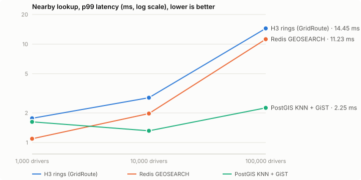

# Benchmarks: nearby lookup at 1k → 100k drivers (claim C5)

_Generated by `python -m bench.report` from `bench/results/`. Do not edit by hand._

**Question.** The 5 nearest drivers within 1 km of a point. **Data.** Driver positions and query points are real June 2016 pickup locations (Manhattan-dense, like the live service), same seed for every backend. **Correctness.** Every answer is scored against an exact brute-force top-5 (recall@5).

## Direct (client → backend, no HTTP)

2,000 queries per cell, one Python client on the same machine as the servers.

| Drivers | Backend | p50 | p99 | Recall@5 | Position writes / s |
|---|---|---|---|---|---|
| 1,000 | H3 rings (GridRoute) | 0.859 ms | 1.764 ms | 0.9997 | 37,796 |
| 1,000 | Redis GEOSEARCH | 0.394 ms | 1.093 ms | 0.9994 | 19,653 |
| 1,000 | PostGIS KNN + GiST | 0.576 ms | 1.624 ms | 1.0000 | 14,809 |
| 10,000 | H3 rings (GridRoute) | 1.520 ms | 2.858 ms | 0.9999 | 24,323 |
| 10,000 | Redis GEOSEARCH | 0.926 ms | 1.972 ms | 0.9977 | 19,030 |
| 10,000 | PostGIS KNN + GiST | 0.526 ms | 1.317 ms | 0.9999 | 13,636 |
| 100,000 | H3 rings (GridRoute) | 4.633 ms | 14.454 ms | 0.9985 | 27,064 |
| 100,000 | Redis GEOSEARCH | 5.746 ms | 11.229 ms | 0.9869 | 17,905 |
| 100,000 | PostGIS KNN + GiST | 1.045 ms | 2.252 ms | 0.9989 | 10,502 |

## Under load (k6, constant arrival rate)

500 requests/s for 20s per cell through one identical FastAPI endpoint (`bench/api.py`, 4 workers), so the HTTP cost is the same for every backend.

| Drivers | Backend | p50 | p90 | p99 | Achieved req/s | Failed |
|---|---|---|---|---|---|---|
| 1,000 | H3 rings (GridRoute) | 3.60 ms | 9.38 ms | 41.87 ms | 500 | 0.00% |
| 1,000 | Redis GEOSEARCH | 1.93 ms | 3.26 ms | 10.04 ms | 500 | 0.00% |
| 1,000 | PostGIS KNN + GiST | 1.84 ms | 2.94 ms | 27.11 ms | 499 | 0.00% |
| 10,000 | H3 rings (GridRoute) | 3.17 ms | 5.17 ms | 11.61 ms | 500 | 0.00% |
| 10,000 | Redis GEOSEARCH | 2.69 ms | 4.38 ms | 11.83 ms | 500 | 0.00% |
| 10,000 | PostGIS KNN + GiST | 1.79 ms | 2.76 ms | 7.17 ms | 500 | 0.00% |
| 100,000 | H3 rings (GridRoute) | 882.15 ms | 3646.08 ms | 3861.53 ms | 236 | 0.00% |
| 100,000 | Redis GEOSEARCH | 1219.93 ms | 4184.61 ms | 5883.19 ms | 186 | 0.00% |
| 100,000 | PostGIS KNN + GiST | 2.41 ms | 4.16 ms | 9.77 ms | 500 | 0.00% |

## What the benchmark changed

The first run had the H3 search making one Redis round trip per ring and ranking every candidate in Python: **2.7 ms p50 at 1k drivers, 21 ms at 100k**. Two changes, both kept exact by the C3 brute-force property test (0/500 wrong):
1. **One round trip.** The ring walk moved into `ring_search.lua`.
2. **Best-first with a distance bound.** At Manhattan density one res-9 cell holds ~150 drivers, and the k+1 ring guard made every query touch ~1,000 of them. The script now visits cells in order of a lower bound on their distance (centre distance − 220 m, the measured max res-9 circumradius in NYC) and stops when no remaining cell can beat the 5th driver found. This is exact within the rings, where the guard was a heuristic.
Result: **0.86 ms at 1k, 1.5 ms at 10k, 4.6 ms at 100k** (4.6× faster at 100k), now ahead of Redis GEO at 100k.

## What it didn't change

- **PostGIS wins pure lookup at high density.** Its KNN walk over the GiST index touches a handful of entries; the H3 search still reads every fresh driver in the cells it can't rule out.
- **One Redis tops out around 200 lookups/s at 100k Manhattan-dense drivers** (k6 above): Redis runs commands on one thread and each lookup costs ~4–6 ms of its CPU at that density. Redis GEO saturates the same way; PostGIS spreads queries over cores. The live matcher needs a few lookups per second (real NYC peak is ~7 requests/s), so this is headroom, not a bottleneck, but it is the ceiling. The upgrade path is the spec's: shard Redis by area (H3 parent cell), or index the densest areas at res 10.
- **Why keep H3 then?** Writes are the hot path (every driver, every 4 s), and H3 is the fastest writer here while doing the most per write; positions, status, leases and freshness change atomically in one place; and the cell IDs are the aggregation keys for the heatmap, the demand history and the forecaster.

## Reading this fairly

- **Writes are not like for like.** A GridRoute position write is `move_driver.lua`: sequence check (drops late pings), status check, cell move, freshness score and driver hash, atomically. `GEOADD` only moves a point, and PostGIS gets its idiomatic bulk path (COPY + one UPDATE).
- **Freshness.** H3 and PostGIS filter by last-ping time in the query; Redis GEO has no notion of freshness (silent drivers need a separate cleanup), which favours it here.
- **One laptop.** Servers, client and load generator share one machine (12 cores, Docker on Windows). Absolute numbers are lower bounds on a real deployment; the comparison is the point.
