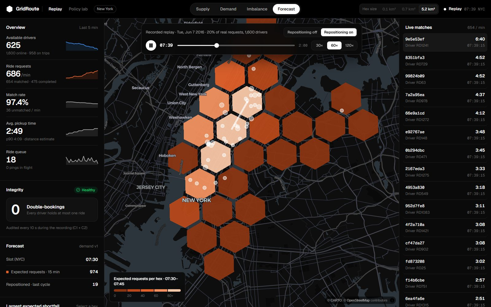

# I built a ride-dispatch engine on Uber's hex grid. Machine learning wasn't the biggest win.

*What I learned replaying 67 million New York taxi trips through a real-time matching system I built from
scratch: a race condition, a GPU-trained ETA model, and the experiment that surprised me.*

> **Try it:** [gridroute.vercel.app](https://gridroute.vercel.app) plays a recorded rush hour in your browser.
> Code: [github.com/prakritiie/gridroute](https://github.com/prakritiie/gridroute).

---

Every ride-hailing app answers the same question thousands of times a second: *which driver should take this
rider?* It looks like a nearest-neighbour lookup. It isn't. Drivers are moving, riders arrive in bursts, two
servers can grab the same driver at the same moment, and "nearest" in a straight line can be six minutes away by
road.

I wanted to understand that problem properly, so I built GridRoute: a real-time dispatch engine on Uber's open
H3 hexagonal grid, with a learned ETA model and a demand forecaster. Then I measured it the honest way. I
replayed real New York demand through the live system, changed one thing at a time, and kept the numbers that
came out even when they weren't the ones I hoped for.

This post covers the decisions that mattered, the bugs that taught me the most, and the result that changed how
I think about where ML belongs in a system like this.

## The shape of the system

A dispatch system has two loops running at different speeds.

**The fast loop** handles locations. Thousands of drivers send a GPS ping every few seconds. Each ping has to land
in a spatial index quickly enough that the next search sees it.

**The slower loop** handles decisions. Every couple of seconds, look at the riders waiting, find candidate drivers
near each, decide who goes where, and claim those drivers so nobody else can.

I kept the live state in a single Redis and made every service around it stateless: a FastAPI gateway, an ingest
worker, a matcher, a reaper for silent drivers, an aggregator for the dashboard, and later a forecaster and a
repositioner. Redis Streams carry pings and ride requests between them. Everything runs with one
`docker compose up`.

## Hexagons instead of radius queries

The obvious way to find nearby drivers is a geospatial radius query. Redis even has one built in (`GEOSEARCH`).
I used H3 instead. H3 divides the planet into hexagons at fixed resolutions. At resolution 9, each cell is about
0.1 km², roughly a few city blocks. A driver's location becomes a cell ID, and "nearby" becomes "this cell and
its rings of neighbours".

Hexagons have one property squares don't: every neighbour is the same distance from the centre. That makes ring
search behave the same in every direction, and it makes everything else easy to aggregate. Supply per cell,
demand per cell and imbalance per cell are just counts at any zoom level.

Each driver lives in a sorted set per cell, scored by the timestamp of their last ping. Finding candidates means
walking rings of cells outward and stopping when you have enough. **Except that stopping early is subtly wrong.**
A driver at the far edge of ring 1 can be farther away than one at the near edge of ring 2. My first version
returned the wrong top-5 on 285 of 500 test queries.

The fix was to walk cells *best-first*, ordered by a lower bound on how close any point in that cell could be. I
stop only when the next cell's bound is worse than the k-th best driver found so far. After that change, it
matched brute force on all 500 queries. A benchmark against Redis GEO and PostGIS later pushed me to move the
whole walk into a single Lua script, which made it 4.6× faster at 100k drivers.

## The bug every dispatch system has to prevent: double-booking

Two matcher processes look at the same idle driver at the same moment. Both see "available". Both assign them.
One driver now has two riders.

This is a classic check-then-act race. I didn't want to argue about it in the abstract, so I built a harness:
16 processes racing to claim the same 50 drivers. A naive "read status, then write assignment" version
double-booked **146 times**.

The fix is to make the check and the write one indivisible step. Redis runs Lua scripts atomically, so
`claim_driver.lua` does everything at once:
- checks the driver is still available, fresh, and not locked;
- removes them from the spatial index;
- writes the offer with a 15-second lease;
- marks the ride as offered.

Either all of it happens or none of it does. Under the same harness: **0 double-bookings across more than 1,000
real conflicts.** The live system also audits this invariant every 10 seconds and shows the count on the
dashboard. It has stayed at zero through everything I've thrown at it since.

The lease matters as much as the lock. If the driver's app never accepts (connection dropped, phone died), the
lease expires, the reaper puts the ride back in the queue, and the driver returns to the index. Any state that
can be orphaned needs something that comes back for it.

## Real data, real roads

Synthetic data would have flattered everything, so I used the NYC Taxi & Limousine Commission's 2016 trip
records. That's 69.4 million trips from January to June, 67.0 million after cleaning out impossible durations,
speeds and coordinates. I processed them with DuckDB. January to April became training data, May validation,
and June the test month that nothing is ever tuned on.

For road distances I ran OSRM on an OpenStreetMap extract of New York. The first useful finding came before any
model existed: **real taxi trips took 1.85× longer than OSRM's free-flow estimate.** Using raw OSRM times as
"the ETA" was off by 7.4 minutes on average. Rush hour, traffic lights and double-parked delivery trucks don't
appear in a road graph.

## A learned ETA, trained on the GPU

The ETA model is LightGBM predicting `log(duration)` from:
- OSRM's distance and time;
- the H3 cells at both ends;
- hour of week and holidays;
- historical speeds per cell and hour.

I trained it on 1.2 million trips using LightGBM's CUDA learner on a laptop RTX 3050, in about 13 minutes.

One rule mattered more than any hyperparameter: **the same function builds the features for training and for
serving.** The matcher imports exactly the code the training script used, and a test checks they agree. Most
real-world model failures I've read about are skew between those two paths.

On June trips it had never seen:

| Mean absolute error | Raw OSRM | Hex-and-hour speed baseline | **Model** |
|---|---|---|---|
| All trips | 7.37 min | 5.08 min | **3.08 min** |
| Under 3 km (pickup-like) | 5.39 min | 2.94 min | **2.27 min** |

A 39% improvement on the strongest baseline. I was confident this would transform dispatch. It didn't, quite.

## The experiment

To measure dispatch quality I built a replay harness:
- It takes a real window (Tuesday 7 June 2016, 07:00–09:00) and a 20% sample of the real ride requests.
- It sends them to the live system at their real times, compressed 10×.
- 1,600 simulated drivers follow real streets over OSRM routes, slowed by measured June congestion.
- Every event is recorded to Parquet.
- Three seeds per configuration, one change per row.

| Row | Matching | Cost | Repositioning | Pickup mean | Riders unserved | Empty km / driver-h |
|---|---|---|---|---|---|---|
| R0 | Greedy | Straight-line distance | Off | 4:49 | 13.98% | 1.77 |
| R1 | Greedy | ETA model | Off | 4:45 | 12.67% | 1.75 |
| R2 | Batch (Hungarian) | Straight-line distance | Off | 4:25 | 14.12% | 1.62 |
| R3 | Batch | ETA model | Off | 4:19 | 13.45% | 1.59 |
| R4 | Batch | ETA model | On | 3:59 | 7.40% | 1.97 |

### Surprise 1: the model barely mattered on its own

Swapping straight-line distance for the learned ETA in a greedy matcher (R0 → R1) moved the average pickup by
four seconds. That's within noise.

The reason became obvious once I built an "explain this match" panel that shows every candidate a match
considered. With five nearby candidates, distance and drive time usually agree on who's best. When they disagree
the model is clearly right: the panel shows drivers 47 m away by air and over six minutes by road, thanks to
Manhattan's one-way streets. But that case is rare enough to disappear in an average.

### Surprise 2: the algorithm beat the model

Greedy matching assigns each rider the moment they arrive. Batch matching collects two seconds of riders and
solves the assignment jointly with the Hungarian algorithm, so one rider doesn't take the driver who was the
only good option for another. That change alone (R0 → R2) cut pickup times by 24 seconds and empty driving by
9%, well outside the seed spread. **A 1955 algorithm beat a GPU-trained model.**

The model's value showed up *inside* the batch: R3 is the best of the first four rows. It also showed up
somewhere I hadn't been measuring. The ETA the rider is told was off by 2:41 with the distance heuristic and by
1:22 with the model. That doesn't change who gets matched, but it changes whether the app is telling the truth.

### Surprise 3: the real problem was where the drivers were

Every matching policy left about 13–14% of riders unserved. The recordings showed why: in the slots where riders
gave up, a median of around 600 drivers were sitting idle. They were just in the wrong place, waiting where
their last trip ended while demand built up elsewhere.

No assignment algorithm can fix that, because it can only pick from the drivers who are already nearby. So I
trained a second model: a Poisson LightGBM forecasting requests per area for the next 15 minutes. It scores
8.4% WAPE on June, against 11.5% for a four-week seasonal average. A repositioner uses it every two simulated
minutes. It takes each area's surplus of idle drivers over forecast demand and sends 20% of it toward the
neighbouring area with the biggest expected shortfall. Moved drivers stay available, so a ride offer on the way
still wins.

**Unserved riders fell from 13.45% to 7.40%**, about 390 more rides served in two hours, and pickups dropped
another 20 seconds. The cost was real: 24% more empty driving, almost all of it the repositioning trips
themselves. Whether that trade is worth it is a business decision. The experiment's job is to put an honest
number on both sides.

The lesson I took away: **the biggest gains came from changing what decision gets made, not from predicting
better within the old decision.** The ETA model made matching slightly better. The forecast made a *new* decision
possible.

## Bugs that taught me more than the features

**A 16-hour laptop sleep.** I left the live demo running, closed the lid, and came back to 1,634 rides stuck in
"assigned" with drivers whose records had expired. Nothing reclaimed a ride when the driver vanished during a
trip, as opposed to during an offer. I added an index of open rides and a sweep that closes any ride whose
driver no longer holds it. The live audit went from 706 violations to 0.

**A reset that reset too much.** My replay harness started each run with `FLUSHDB`. That also deleted the Redis
consumer groups and the pointer to the current model, so 94% of one test run silently fell back to the baseline
ETA. Now resets delete only simulation state, and every worker recreates its consumer group if it disappears.

**An audit that got slower every hour.** The invariant audit scanned every ride ever created. At 58,000 rides it
took 7 seconds. An index of *open* rides, maintained inside the same Lua scripts that change ride status, made it
constant time.

**The routing engine was the bottleneck.** Batch scoring needs a many-to-many travel-time table. OSRM's default
algorithm took about a second for a 160×20 table. Switching to contraction hierarchies brought it to 45 ms with
identical results, which I checked on every pair.

None of these show up in a design doc. All of them show up the first time a system runs for longer than a demo.

## Breaking it on purpose

The console has a chaos panel:
- silence 30% of drivers in an area;
- multiply demand by ten;
- deliver GPS pings out of order.

Then you watch it recover:
- silenced drivers drop out of search within about 30 seconds and come back on their first ping;
- out-of-order pings are rejected by the sequence check in the Lua script (6,920 in one run, with zero invariant
  violations);
- a demand burst fills the queue, which drains.

Through all of it, the double-booking counter stays at zero.

## What I'd do next

- **Train the ETA on pickup-like legs.** Cleaned taxi trips exclude anything under 300 m, so the model never
  predicts less than about two minutes, even for a driver around the corner.
- **Make repositioning cost-aware.** It currently ignores the empty kilometres it creates; a version that weighs
  expected gain against driving cost would trade more carefully.
- **Shard the location index.** One Redis tops out around 200 nearby-searches per second at 100k drivers in
  Manhattan density. The benchmark makes that limit visible rather than hypothetical.

## Takeaways

1. **Correctness first, as a property you can test.** "No double-booking" became a 16-process race test and a
   live counter, not a code review comment.
2. **Measure the system, not just the model.** A 39% better ETA moved pickups by seconds; a scheduling change
   moved them by tens of seconds.
3. **Put ML where it changes a decision.** Forecasting didn't make matching better. It made repositioning
   possible, and that's where the biggest gain was.
4. **Report the cost next to the win.** Repositioning halved unserved riders and added 24% empty driving. Both
   numbers belong in the same sentence.

The demo is at [gridroute.vercel.app](https://gridroute.vercel.app) and the code, results and model cards are on
[GitHub](https://github.com/prakritiie/gridroute).

---

*Stack: Python, FastAPI, Redis (Lua, Streams), H3, OSRM, LightGBM (CUDA), SciPy, DuckDB, Docker Compose,
Prometheus, Grafana, Next.js, deck.gl, MapLibre. Data: NYC TLC 2016 Yellow Taxi Trip Records via NYC Open Data.*
