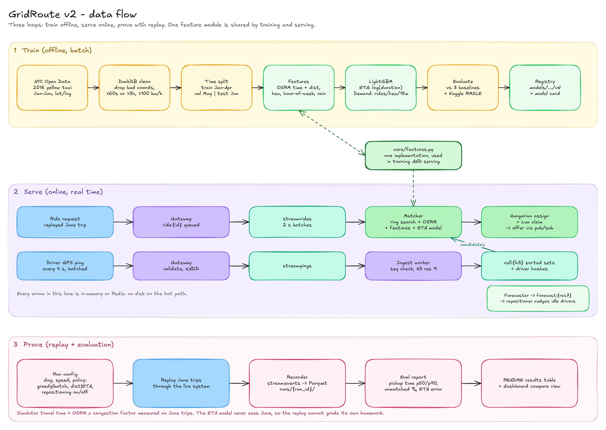
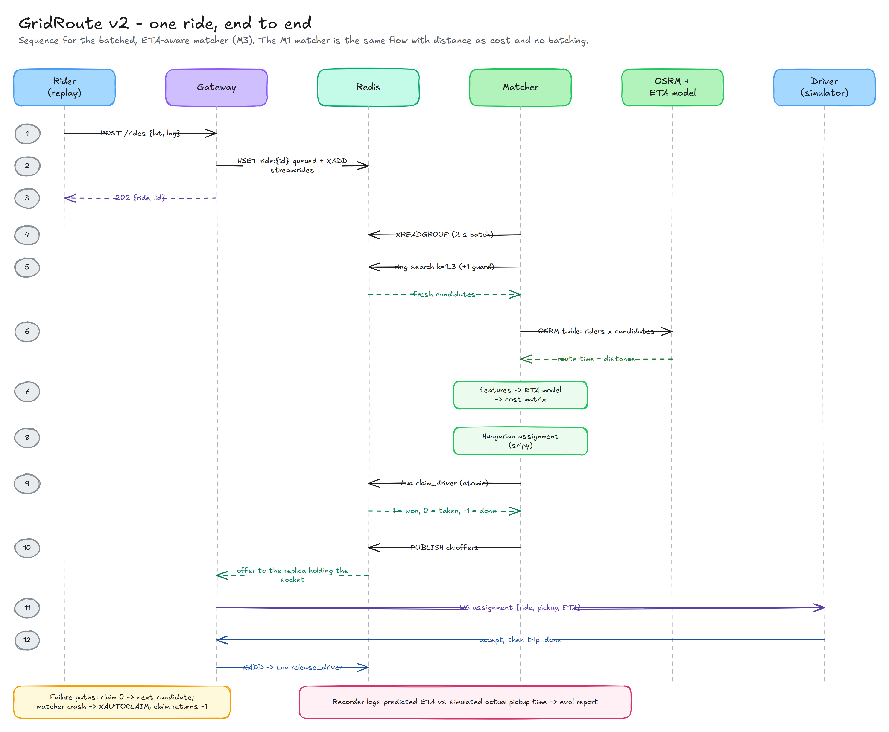
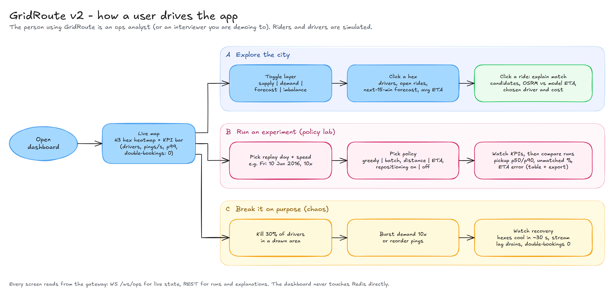

# GridRoute v2: implementation spec

> **GridRoute is a real-time ride-dispatch engine.** It indexes moving drivers into Uber's H3 hexagonal grid and matches riders using **learned pickup-time predictions** instead of straight-line distance. It **forecasts demand** so idle drivers can move to where rides are about to appear, and it guarantees that no driver is ever double-booked. Every claim is proven on **real NYC trip data** with a replay harness and fair baselines.

| | |
|---|---|
| **Owner** | Priyanshu |
| **Version** | v2 (adds the learned ETA model and demand forecasting to v1's real-time core) |
| **Status (3 Oct 2026)** | Design locked. Prototype Lua scripts and ring search verified against real Redis. Build starts **Mon 5 Oct 2026**. |
| **Milestones** | M1 core engine by **25 Oct** · M2 real data and proof by **8 Nov** · M3 intelligence by **29 Nov** · M4 polish and ship by **13 Dec** |
| **Stack** | Python 3.12 · FastAPI · Redis 7 · h3-py 4 · OSRM · DuckDB · LightGBM · SciPy · Next.js + deck.gl · Docker Compose · k6 · Prometheus/Grafana |
| **Diagrams** | `diagrams/architecture-v3.png` (main, with connection table); Excalidraw diagrams `diagrams/0*.png` / `.excalidraw` |

**Contents:** 1 Problem statement · 2 Solution · 3 MVP scope · 4 Architecture · 5 Data · 6 Data flow · 7 User flows · 8 ML design · 9 Tech stack · 10 Real-time core · 11 APIs · 12 Repo layout · 13 Implementation plan · 14 Tests · 15 Metrics · 16 Risks · 17 Interview prep · 18 Day 1

---

## 1. Problem statement

### 1.1 The problem
A ride-hailing marketplace must decide, every few seconds, **which available driver should pick up which waiting rider**.

- Thousands of drivers report their GPS position about every 4 seconds.
- Riders request rides unpredictably, with sharp peaks.
- Each decision has to be **fast** (well under a second), **correct** (never two rides for one driver), and **good**: shortest real pickup time, not shortest straight-line distance.
- Supply and demand are rarely in the same place, so a good system also **anticipates** where rides will appear next.

### 1.2 Why this is hard
| # | Difficulty | Why a naive approach fails |
|---|---|---|
| 1 | Write-heavy moving state | 10k drivers × 1 ping per 4 s = 2,500 writes/s before any ride exists. A disk database spends its time just keeping up. |
| 2 | Proximity on moving data | "Who is near this point?" must be answered against positions that are seconds old. |
| 3 | Concurrency | Several matchers share one driver pool. "Check free, then take" is a race condition: in the prototype, a naive version double-booked 17–18 drivers under load. |
| 4 | Partial failure | Driver apps die silently, pings arrive out of order, messages get lost. The system has to heal itself. |
| 5 | Decision quality | The closest driver by straight line is often not the fastest (rivers, one-way grids, rush hour). Greedy one-at-a-time matching is locally good but globally poor. |
| 6 | Supply–demand mismatch | Idle drivers cluster where their last trip ended, not where the next rides will be requested. |

### 1.3 What the project must prove
| # | Claim | Proof | Milestone |
|---|---|---|---|
| C1 | No driver is ever double-booked | Concurrency test with 16 matcher processes; audit shows 0 duplicates (already true in the prototype) | M1 |
| C2 | Location state stays consistent | Invariant audit: every fresh, available driver is in exactly one cell | M1 |
| C3 | Nearby lookup is correct | Ring search top-N = brute force top-N (prototype: 0/500 wrong with the k+1 guard, 115/500 without) | M1 |
| C4 | The system heals itself | Killed drivers leave search within ~35 s; late pings are ignored; lost `trip_done` is freed by lease expiry | M1 |
| C5 | The core is fast, measured fairly | k6 benchmarks vs Redis GEO and PostGIS on the same data, p50/p99 at 1k → 100k drivers | M2 |
| C6 | Learned ETA beats real baselines | On held-out June 2016 trips, the model beats raw OSRM and a historical hex-hour speed table; Kaggle RMSLE reported | M3 |
| C7 | Better predictions make better dispatch | Replay of real June demand: pickup time and unmatched rate for each matching policy (§8.4) | M3 |
| C8 | Forecasting helps, at a stated cost | Forecast beats "same slot last week"; repositioning's effect on pickup time **and** extra empty kilometers reported | M3 |

### 1.4 Non-goals
Payments, auth, real driver/rider apps, surge pricing, multi-city deployment, LLM features. Each one is a one-sentence answer in an interview ("here's how I'd add it"), not code. LLMs stay out of the dispatch path deliberately: too slow and too unpredictable for a millisecond decision loop.

---

## 2. Solution explanation

### 2.1 In plain words (the dispatch-office analogy)
- **The wall map.** The city is divided into honeycomb tiles (H3 hexagons). Every driver is a pin on a tile. *(Redis sorted set per hexagon.)*
- **Radio messages.** Drivers radio their position every few seconds. Messages land in an inbox tray, and a clerk moves each pin to its new tile in one motion. *(Gateway → Redis Stream → ingest worker → atomic Lua script.)*
- **The dispatcher.** Every 2 seconds the dispatcher collects new calls. For each caller, they look at nearby tiles for free drivers. Instead of trusting straight-line distance, they ask **an experienced navigator** how long each driver would really take: that's the ETA model, trained on millions of real NYC trips. Then they assign all calls together so the total wait is smallest. *(Batched matcher + OSRM + LightGBM + Hungarian algorithm.)*
- **The key rule.** Each driver has one physical key. Whoever takes it owns that driver; no two dispatchers can send the same taxi. *(Atomic Lua claim with a lease.)*
- **The planner.** A planner studies past demand and predicts which tiles will be busy in 15 minutes, then nudges idle drivers toward them. *(Demand forecaster + repositioner.)*
- **The janitor** removes pins of drivers who stopped radioing. *(Reaper.)*
- **The big screen** shows everything live, and lets an analyst replay a real day with different policies and compare results. *(Ops dashboard + policy lab.)*

### 2.2 Layered design
| Layer | Job | Components | Milestone |
|---|---|---|---|
| Real-time core | Hold live state and keep it correct | Gateway, Redis, ingest, reaper, aggregator, Lua scripts | M1 |
| Decision | Pick the best driver for each ride | Ring search, OSRM, ETA model, batch assignment, claim | M1 (greedy) → M3 (ETA + batch) |
| Anticipation | Move supply toward future demand | Demand model, forecaster, repositioner | M3 |
| Evidence | Prove every claim on real data | Data pipeline, replay, recorder, eval report, k6, baselines | M2 |
| Experience | Make it visible and explorable | Ops dashboard, policy lab, chaos controls, static demo site | M1 → M4 |

### 2.3 Three design rules everything follows from
1. **Redis is the only place live state lives.** Gateway and workers are stateless and can crash or scale freely.
2. **Every multi-key write is a Lua script.** That's what makes C1, C2 and C4 hold.
3. **Models are trained on Jan–Apr 2016 and judged on June 2016.** The simulator's "true" travel times come from June data the model never saw, so the replay can't grade its own homework.

---

## 3. MVP scope

Each milestone is a usable, demoable product with a hard gate. Don't start the next one until the gate passes.

### M1: Core engine (5 – 25 Oct)
| In | Out (later) |
|---|---|
| Driver simulator (5–10k drivers, random destinations in NYC) | Real taxi replay (M2) |
| Gateway: WS pings, `POST /rides`, `GET /hexes`, `/metrics` | Policy lab, chaos UI (M4) |
| Ingest worker + `move_driver.lua` | OSRM, ETA, batching (M2/M3) |
| Ring search with k+1 guard; **greedy** matcher, cost = distance | Forecasting (M3) |
| `claim_driver.lua`, `release_driver.lua`, reaper, aggregator | |
| Dashboard v1: live hex heatmap + KPI bar | |
| Audit tool + CI (GitHub Actions with a Redis service) | |

**Gate:** C1–C4 tests green in CI; 60-second demo GIF recorded.

### M2: Real data and proof (26 Oct – 8 Nov)
| In | Out (later) |
|---|---|
| Data pipeline: NYC 2016 trips → DuckDB cleaning → Parquet, plus data card | ML models (M3) |
| OSRM container on the NYC road graph | |
| Rider replay of June 2016 trips; recorder; eval report v0 | |
| Offer/accept flow with 15 s leases | |
| k6 benchmarks vs Redis GEO and PostGIS; Prometheus + Grafana | |

**Gate:** baseline replay numbers for the greedy + distance policy; benchmarks reproducible within ~10% across 3 runs.

### M3: Intelligence (9 – 29 Nov)
| In | Out |
|---|---|
| `core/features.py` shared by training and serving | Deep-learning ETA (LightGBM first; DL only with a measured reason) |
| ETA model: train, evaluate vs 3 baselines + Kaggle, model card | Online learning, A/B tests on real users |
| Matcher uses OSRM + ETA model; Hungarian batch assignment | Surge pricing |
| "Explain this match" API + dashboard panel | |
| Demand model + forecaster + repositioner | |

**Gate:** results table (§8.4) filled in from replay, with 3 seeds per row.

### M4: Polish and ship (30 Nov – 13 Dec)
Policy lab and chaos controls in the dashboard; static demo site on Vercel; README; blog post; resume bullets with real numbers. This milestone doubles as the schedule buffer.

**Cut list (won't build):** EV/battery scoring, LLM chat features, auth, payments, Kubernetes.

---

## 4. Architecture


Arrow colour = flow type (telemetry, dispatch, ML/routing, offline data, evaluation, ops). Solid = live path; dashed = periodic, offline, on-publish or test. Every arrow is numbered; see §4.1 for the full list. The full-size version with the connection table is `diagrams/architecture-v3.png`, and the hand-drawn Excalidraw version is kept in `diagrams/01-architecture.*`.

| Component | Responsibility | Tech | Scales by | Milestone |
|---|---|---|---|---|
| Driver simulator | Moves drivers, sends batched pings, reacts to offers | Python, NumPy, asyncio | Processes (sharded drivers) | M1 |
| Rider replay | Replays real June 2016 trips as ride requests, time-compressed | Python, DuckDB | — | M2 |
| Ops dashboard / policy lab | Live map, KPIs, explain-match, experiments, chaos | Next.js, deck.gl `H3HexagonLayer`, MapLibre | Static frontend | M1 → M4 |
| Gateway | Validate, enqueue, push state to clients | FastAPI, uvicorn | Replicas (stateless) | M1 |
| Redis | Streams, cell sets, hashes, locks, forecasts, pub/sub | Redis 7 | One node per city (sharding story) | M1 |
| Ingest | Latest ping per driver → res-9 cell (Lua move) | Python | Consumers in a group | M1 |
| Matcher | Candidates → ETA cost → assignment → Lua claim | Python, SciPy, LightGBM | Partition by region | M1 → M3 |
| Reaper | Evict silent drivers, expire leases | Python | 1 instance | M1 |
| Aggregator | Hex supply/demand snapshot every 500 ms | Python | 1 instance | M1 |
| Recorder | Run events → Parquet for evaluation | Python, PyArrow | 1 instance | M2 |
| OSRM | Road-network route time/distance, many-to-many | OSRM (Docker), OSM data | Replicas | M2 |
| ETA model | Corrects OSRM time using learned traffic patterns | LightGBM (in-process) | With matcher | M3 |
| Forecaster + repositioner | Predict demand per res-7 hex; nudge idle drivers | LightGBM, Python | 1 instance each | M3 |
| Model registry | Versioned model artifacts with metrics and cards | Folder + JSON (`models/{name}/vN`) | — | M3 |

### 4.1 Connection reference (every arrow in the diagram)
| # | From → To | Kind | Mechanism | What flows |
|---|---|---|---|---|
| 1 | Driver simulator → Gateway | live | `WS /ws/driver` | Batched GPS pings (seq, ts) every 4 s; accept; trip_done |
| 2 | Gateway → Driver simulator | live | `WS /ws/driver` | assignment {ride, pickup, eta_s}; reposition {target_cell} |
| 3 | Rider replay → Gateway | live | `HTTP POST /runs, /rides` | Run config + May demand history seed, then June ride requests |
| 4 | Ops dashboard ↔ Gateway | live | `WS /ws/ops + REST` | Down: hexes, KPIs, matches. Up: explain, runs, chaos |
| 5 | k6 load generator → Gateway | test | `WS + HTTP` | Constant-arrival-rate load tests (separate process) |
| 6 | Prometheus → All core services | periodic | `HTTP GET /metrics (pull)` | Scrapes histograms and counters every 15 s; Grafana reads Prometheus |
| 7 | Gateway ↔ Redis | live | `XADD, HSET / GET` | Writes stream:pings, stream:rides, ride:{id}; reads snapshot, explain, run |
| 8 | Redis → Gateway | live | `SUBSCRIBE pub/sub` | ch:offers, ch:reposition, ch:hexes, ch:kpis fanned out to sockets |
| 9 | Redis ↔ Ingest worker | live | `XREADGROUP + EVAL` | Reads stream:pings; runs move_driver.lua (seq check, cell move) |
| 10 | Redis ↔ Matcher | live | `XREADGROUP, ZRANGEBYSCORE, EVAL, PUBLISH` | Reads rides + ring cells; claim_driver.lua; publishes offers; logs events |
| 11 | Reaper → Redis | periodic | `ZREMRANGEBYSCORE (every 5 s)` | Evicts drivers silent > 30 s; expires offer leases; re-queues rides |
| 12 | Redis ↔ Aggregator | periodic | `ZCOUNT, SET, PUBLISH (every 500 ms)` | Counts supply/demand per hex; writes snapshot + demand_hist; publishes |
| 13 | Redis ↔ Forecaster | periodic | `LRANGE / HSET (every 5 min)` | Reads demand_hist:{res7}; writes forecast:{res7} |
| 14 | Redis ↔ Repositioner | periodic | `HGET, ZCOUNT, PUBLISH (every 2 min)` | Reads forecast + idle supply; publishes reposition nudges |
| 15 | Redis → Recorder | live | `XREADGROUP stream:events` | Match, pickup, complete and reposition events |
| 16 | Matcher → OSRM | live | `HTTP GET /table (150 ms timeout)` | Route time + distance, candidates x pickups; falls back to B3 on timeout |
| 17 | Model registry → Matcher | on publish | `File load on pointer change` | ETA model vN, hot-reloaded when model:eta:current changes |
| 18 | Model registry → Forecaster | on publish | `File load on pointer change` | Demand model vN, hot-reloaded when model:demand:current changes |
| 19 | NYC Open Data → Download + clean | offline | `HTTPS (Socrata API), monthly` | 2016 yellow-taxi trips, Jan-Jun, with exact coordinates |
| 20 | Download + clean → Data lake | offline | `DuckDB COPY to Parquet` | Clean trips + manifest (rows removed per rule, checksums) |
| 21 | Data lake → Feature builder | offline | `DuckDB scan` | Time splits: train Jan-Apr, val May, test Jun |
| 22 | Feature builder → OSRM | offline | `HTTP GET /table (batched)` | Precomputes route features with the SAME OSRM used online |
| 23 | Feature builder → Train | offline | `Parquet` | Feature tables built by core/features.py (shared with serving) |
| 24 | Train → Evaluate + publish | offline | `Model files` | Candidate LightGBM models (ETA, demand) |
| 25 | Evaluate + publish → Model registry | offline | `Write vN + SET pointer` | Artifact, metrics.json, model card; sets model:*:current in Redis |
| 26 | Data lake → Rider replay | offline | `Parquet read` | Held-out June trips to replay + May history to warm-start forecasts |
| 27 | Data lake → Driver simulator | offline | `Parquet read` | June congestion factors = simulator's true travel time |
| 28 | Recorder → Run store | offline | `Parquet append` | runs/{run_id}/events.parquet |
| 29 | Run store → Eval report | offline | `DuckDB query` | Pickup time p50/p90, unmatched %, empty km, ETA error per policy |
| 30 | Eval report → Results (README) | offline | `Markdown + charts` | The R0-R4 results table |
| 31 | Run store → Static demo site | offline | `Export playback JSON` | Hex snapshots + KPI timeline replayed on Vercel, no backend |
| 32 | Benchmark harness → PostGIS | test | `SQL ST_DWithin (GiST)` | Baseline proximity queries on identical data |
| 33 | Benchmark harness → Results (README) | test | `CSV + charts` | p50/p99 latency curves, 1k to 100k drivers |

**Deliberately not drawn:**
- Benchmark harness -> Redis GEOSEARCH baseline: runs against the same Redis; listed here, omitted in the drawing to avoid a long crossing line.
- Evaluate + publish -> Redis model:*:current pointer write: folded into arrow 25.
- Grafana -> Prometheus queries: both live in one box.

### 4.2 What the arrow audit changed (vs the Excalidraw v2 diagram)
| Problem in v2 | Fix in v3 |
|---|---|
| ETA and demand models drawn as separate services with "predict" arrows, implying a network hop | Models drawn *inside* the matcher and forecaster (in-process LightGBM). The registry feeds them with "load vN" arrows (17, 18). |
| One vague double arrow between Redis and all workers | One arrow per worker with its direction and Redis operations (9–15) |
| Missing: feature builder → OSRM | Added (22). Training features must come from the same OSRM the matcher calls (16), or training and serving drift apart. |
| Rider replay fed from the raw source | Replay reads cleaned June trips from the data lake (26) |
| Missing: data lake → driver simulator | Added (27): June congestion factors are the simulator's ground-truth travel time |
| Repositioner had no path to drivers | Redis `ch:reposition` (14) → gateway (8) → driver WS (2). `ch:reposition` is now in the data model. |
| Gateway → Redis drawn one-way | Two arrows: writes and reads (7), and pub/sub fan-out (8) |
| Recorder → eval report skipped storage | Recorder → run store → eval report / demo site (28–31) |
| Prometheus, k6 and PostGIS missing or ambiguous | Prometheus *pulls* /metrics (6); k6 is a client (5); PostGIS is benchmark-only, in the evaluation band (32) |

---

## 5. Data

### 5.1 Sources (all real and public)
| Purpose | Dataset | What's verified | Milestone |
|---|---|---|---|
| ETA training/evaluation, demand history, rider replay | **NYC Open Data, "2016 Yellow Taxi Trip Data"** (dataset id `uacg-pexx`) | 131M rows for 2016. Columns include `pickup_latitude/longitude`, `dropoff_latitude/longitude` and exact timestamps. Coordinates are filled for **Jan–Jun**; from July the TLC switched to zone IDs (that's why ~47% of coordinates are null). | M2 |
| Public ETA benchmark | **Kaggle "NYC Taxi Trip Duration"** | 1,458,644 training trips from 2016 with coordinates; scored on RMSLE. Best score without external data ≈ 0.362; top scores using OSRM/weather features ≈ 0.29–0.31. | M3 |
| Road network for routing | **OpenStreetMap** NYC extract (Geofabrik New York), clipped to the city | Used by OSRM's car profile. ODbL licence, so attribution goes in the README and on the map. | M2 |
| Optional: real rideshare demand in a second city | **Chicago TNP trips** (actual Uber/Lyft trips) | Times rounded to 15 min and locations aggregated to census tracts for privacy. Fine for testing the demand model elsewhere; too coarse for ETA. | M3 (optional) |
| Optional features | Python `holidays` package; hourly weather for Central Park | Rain and holidays change both speed and demand. | M3 (optional) |

**One caution:** the TLC's own trip-record page now serves Parquet files. I couldn't confirm those historical files still carry coordinates, so the pipeline uses the NYC Open Data version, which does. Check the schema before switching sources.

### 5.2 Cleaning rules (each one logs how many rows it removed)
1. Pickup and dropoff inside the NYC bounding box (lat 40.47–40.92, lng −74.27 to −73.68).
2. Duration between 60 s and 3 h.
3. Implied speed between 1 and 100 km/h, using OSRM distance once available, otherwise straight-line × 1.3.
4. Straight-line distance ≥ 300 m (shorter trips are mostly meter errors).
5. Drop exact duplicates and zero-coordinate rows.

### 5.3 Time split (never random)
| Split | Months | Used for |
|---|---|---|
| Train | Jan–Apr 2016 | Fitting both models; also the congestion statistics behind baseline B3 |
| Validate | May 2016 | Early stopping, hyperparameters, and warm-start history for the forecaster |
| Test | June 2016 | Final offline metrics **and** the replay month; also the simulator's ground-truth congestion factors |

Random splits leak future traffic into training. Interviewers check for this.

### 5.4 How the data is managed
- **Not in git.** `make data` downloads month by month from the Open Data API, converts to Parquet with DuckDB, applies the cleaning rules and writes `data/manifest.json` (source URL, query, row counts per rule, SHA-256 of outputs).
- **Size:** keep only the needed columns. For training iterations, use a fixed 10–20% sample; final numbers use the full test month.
- **OSRM features offline:** precompute route time and distance for the training sample with batched `table` calls against the local OSRM container. Expect hours, not minutes, so cache to Parquet once.
- **Shareable artifacts:** a 100k-row sample, the trained models and the data/model cards go into a GitHub Release, so `docker compose up` works without the full download.
- **Cards:** `docs/data_card.md` (source, licence, period, cleaning counts, known biases: yellow cabs only, Manhattan-heavy, 2016 traffic) and `models/eta/vN/card.md` (features, metrics by slice, failure cases).

---

## 6. Data flow



### 6.1 Train (offline, batch)
NYC Open Data → DuckDB clean → time split → `core/features.py` → LightGBM (ETA and demand) → evaluate on June vs baselines → publish `models/{eta,demand}/vN` with `metrics.json` and `card.md`.

### 6.2 Serve (online, real time)
- **Pings:** driver → gateway (validate, `XADD stream:pings`) → ingest (dedupe, seq check, H3 res 9) → `move_driver.lua` → cell sorted sets + driver hash.
- **Rides:** rider → gateway (`ride:{id}` queued, `XADD stream:rides`) → matcher, every 2 s:
  1. Ring search for candidates.
  2. One OSRM `table` call (candidates × pickups).
  3. `features.py` → ETA model → cost matrix.
  4. Hungarian assignment.
  5. `claim_driver.lua` per pair.
  6. `PUBLISH ch:offers`, then the gateway pushes the offer to the driver.
- **Forecast:** every 5 min (sim time), the forecaster reads 15-min demand history per res-7 hex → demand model → `forecast:{res7}`. The repositioner compares forecast vs idle supply and sends `reposition` messages to idle drivers.
- **Display:** aggregator → `hexes:snapshot` + `ch:hexes` → gateway → dashboard.

Nothing on this path touches disk. Models are loaded in-process, and the matcher hot-reloads when `model:eta:current` changes.

### 6.3 Prove (replay + evaluation)
Run config (day, speed, policy, seed) → June trips replayed through the live system → recorder (`stream:events` → `runs/{run_id}/*.parquet`) → eval report → README table and dashboard compare view.

**Avoiding self-grading:** simulated drivers travel at *OSRM time × congestion factor*, where the factor is the median of (actual ÷ OSRM) per res-8 hex and hour-of-week, **computed from June trips**. The ETA model never sees June. Both still share OSRM as a base, so state that limitation in the README.

---

## 7. User flows

### 7.1 Who uses GridRoute
| User | What they do | Where |
|---|---|---|
| **Ops analyst** (or the interviewer you demo to) | Watches the city, inspects matches, runs experiments, breaks things on purpose | Dashboard |
| **Rider / driver** | Simulated: request, get matched, travel | Simulator + replay |
| **ML engineer** (you) | Trains, evaluates and publishes models; watches online error | CLI + dashboard |
| **Recruiter** | Skims the README, clicks the demo, reads the results | GitHub + static site |

### 7.2 One ride, end to end


1. Rider calls `POST /rides`. The gateway writes `ride:{id}` as `queued`, appends to `stream:rides`, and returns `202` immediately.
2. Within 2 s the matcher reads the batch and ring-searches nearby cells (k = 1…3, plus one extra ring).
3. One OSRM `table` call returns road time and distance for every candidate–pickup pair.
4. The ETA model turns those plus context (hex, hour, holiday, rain) into predicted pickup times, which form the cost matrix.
5. The Hungarian algorithm picks the assignment with the lowest total predicted pickup time across the batch.
6. `claim_driver.lua` claims each pair atomically. If a driver was taken (0), the ride falls to its next candidate or the next batch. If the ride was already handled (−1), the matcher only re-publishes.
7. The offer goes via pub/sub to the gateway replica holding the driver's socket. The driver accepts (15 s lease), drives, and sends `trip_done`, which triggers `release_driver.lua`.
8. The recorder logs predicted vs simulated-actual pickup time for the eval report.

### 7.3 Ops analyst journeys


- **A. Explore:**
  - Toggle the map layer between supply, demand, forecast and imbalance.
  - Click a hex to see its drivers, open rides, 15-minute forecast and average ETA.
  - Click a ride to **explain the match**: candidates, OSRM vs model ETA, the chosen driver and the cost.
- **B. Experiment (policy lab):**
  - Pick a June 2016 day and a replay speed.
  - Pick a policy: greedy or batch, distance or ETA cost, repositioning on or off.
  - Watch the KPIs, then compare runs side by side and export.
- **C. Chaos:**
  - Kill 30% of drivers inside a drawn area, burst demand 10×, or reorder pings.
  - Watch recovery: hexes cool in ~30 s, stream lag drains, and the double-booking counter stays at 0.

### 7.4 ML engineer loop
`make data` → `make train MODEL=eta` → `make eval` (prints a metrics table vs the current version and every baseline) → if better, `make publish` writes `models/eta/v4` and sets `model:eta:current=v4` → the matcher hot-reloads within 30 s → the dashboard shows the model version and its rolling online error.

### 7.5 Recruiter journey
README hero GIF → one-line pitch → results table → **"Try the demo"** link (a static Vercel site that plays back a recorded run: hex snapshots + KPI timeline, no backend needed) → architecture diagram → code.

---

## 8. ML design

### 8.1 ETA model
| Aspect | Decision |
|---|---|
| Question answered | "How many seconds for a car at A to reach B, leaving now?" |
| Target | `log1p(duration_s)`, so short and long trips are weighted fairly |
| Training data | Train-split trips; a fixed sample with OSRM features precomputed |
| Features (all known at dispatch time) | OSRM duration and distance; straight-line distance; bearing; pickup and dropoff res-8 hex; hour-of-week; holiday flag; airport flag (JFK/LGA zones); rain (optional) |
| Excluded on purpose | Fare, tip, payment type, dropoff time, passenger count (unknown at dispatch, or leak the answer) |
| Model | LightGBM regressor; early stopping on May |
| Why it corrects OSRM | Routing engines know roads but not real traffic. Learning the gap between OSRM and reality is the same idea Uber describes for DeepETA, at portfolio scale. |

**Baselines (the model must beat all three):**
| ID | Baseline |
|---|---|
| B1 | Straight-line distance ÷ city-wide average speed |
| B2 | Raw OSRM duration |
| B3 | OSRM distance ÷ historical median speed for (pickup res-8 hex, hour-of-week), computed from training months |

**Metrics:** MAE (s), MAPE, p90 absolute error and RMSLE, sliced by distance bucket (**< 3 km mirrors real pickup legs**), borough/airport, and hour. Separately, run the same pipeline on Kaggle's train/test split and record RMSLE next to the public reference points (≈ 0.362 without external data, ≈ 0.29–0.31 with OSRM-style features). Don't set a target in advance; report what you get.

**Serving:**
- One OSRM `table` request per batch, then `booster.predict` on at most a few hundred rows.
- Budget: the whole decision for a 2-second batch should stay well under 200 ms. Measure it and put the real p99 in the README.
- **Fallback:** if OSRM times out (> 150 ms), use B3 and increment `eta_fallback_total`. The matcher never blocks on the model.
- **Training/serving parity:** both paths call the same `features.py` function. A test asserts identical outputs on 1,000 fixed rows.

### 8.2 Demand model
| Aspect | Decision |
|---|---|
| Question answered | "How many ride requests will this res-7 hex (~5 km²) get in the next 15 minutes?" |
| Target | Count per (res-7 hex, 15-min slot) |
| Features | Last slot, last hour (sum of 4), same slot yesterday (lag 96), same slot last week (lag 672), hour-of-week, holiday, rain; hex as a categorical |
| Model | One global LightGBM across all hexes, Poisson or Tweedie objective (counts) |
| Baselines | Seasonal naive (same slot last week); 4-week moving average of that slot |
| Metrics | WAPE and MAE per hex, sliced into busy vs quiet hexes |
| Serving | History lives in Redis as `demand_hist:{res7}` (last 7 days of 15-min counts), warm-started from May data when a replay begins |

### 8.3 Repositioning policy
Every 2 min of sim time:
1. For each res-7 hex: `gap = forecast_next_15m − idle_drivers`.
2. Hexes with surplus (`idle − forecast > 2`) send at most 20% of their surplus to the neighbouring hex (k = 1) with the largest positive gap.
3. Total moves per cycle are capped. Repositioning drivers stay matchable while moving.

Report the benefit (pickup time, unmatched rate) **and the cost** (extra empty km per driver-hour). That trade-off is the honest headline, not the benefit alone.

### 8.4 Evaluation protocol and results table
- **Fixed conditions:** 3 June weekdays + 1 weekend day, the same initial fleet, 3 random seeds per policy. Report mean ± spread.
- Each row changes exactly one thing, so improvements can be attributed.

| Row | Matching | Cost | Repositioning | Pickup mean | Pickup p90 | Unmatched % | Empty km / driver-h | Decision p99 |
|---|---|---|---|---|---|---|---|---|
| R0 | Greedy | Distance | Off | | | | | |
| R1 | Greedy | ETA model | Off | | | | | |
| R2 | Batch (Hungarian) | Distance | Off | | | | | |
| R3 | Batch | ETA model | Off | | | | | |
| R4 | Batch | ETA model | On | | | | | |

"Pickup time" here is the simulated true time (OSRM × June congestion), not the model's own prediction.

---

## 9. Tech stack and trade-offs

| Layer | Pick | Considered | Why this pick | What it costs |
|---|---|---|---|---|
| Language | Python 3.12 | Go, Node.js | One ecosystem for h3, NumPy, SciPy and LightGBM; the hot path waits on Redis | GIL → workers run as separate processes; Go would be faster per core |
| API | FastAPI + uvicorn | Flask, aiohttp | Async + WebSockets + typed models + OpenAPI docs | Per-ping validation overhead → validate batches, `msgspec` on hot paths |
| Driver transport | WebSocket, batched frames | HTTP per ping, gRPC, MQTT | One socket carries pings up and offers down | Sticky connections; per-replica socket registry |
| Live state | Redis 7 | Postgres, in-process memory, Redis Cluster | Sub-millisecond ops; data structures fit; Lua atomicity | Single point of failure; state is rebuildable from pings within 4 s |
| Queues | Redis Streams | Kafka, RabbitMQ | Already running; consumer groups, acks, replay, `XAUTOCLAIM` | No partitions → Kafka by H3 parent cell at multi-city scale |
| Spatial index | H3 res-9 cells as sorted sets | Redis GEO, PostGIS GiST, KD-tree, S2 | Uniform neighbours; cell IDs double as aggregation keys; hierarchy for res-7 forecasts | May not beat `GEOSEARCH` on raw lookup; benchmark decides |
| Atomicity | Lua scripts | `WATCH`/`MULTI`, Redlock, `SELECT … FOR UPDATE SKIP LOCKED` | One round trip, no retry storms | Scripts must stay tiny; Cluster needs hash-tagged keys |
| Routing | OSRM (self-hosted) | Valhalla, GraphHopper, Google Maps API | Fast many-to-many `table` API, free, offline, open data | Static speeds, no live traffic (that's the ETA model's job) |
| Data processing | DuckDB + Parquet | pandas only, Spark | SQL over tens of millions of rows on a laptop, no cluster | Single machine (enough here) |
| ML models | LightGBM | XGBoost, neural ETA (DeepETA-style), Prophet | Strong on tabular data, fast to train, microsecond inference, built-in feature importance | Less expressive than deep models; justified until a measured gap appears |
| Assignment | `scipy.optimize.linear_sum_assignment` | Auction algorithm, min-cost flow, OR-Tools | Exact, fast for batches of hundreds | Cubic cost → partition by region for big batches |
| Model registry | Versioned folders + JSON + Redis pointer | MLflow | Zero extra services; easy to explain | No UI → MLflow is the upgrade path |
| Dashboard | Next.js + deck.gl `H3HexagonLayer` + MapLibre | Streamlit, Leaflet, Kepler.gl | Your strongest skill; GPU-rendered H3 layer; no map API token | More effort than Streamlit → timebox |
| Load testing | k6 (`constant-arrival-rate`) | Locust, wrk | Open workload model avoids coordinated omission; WebSocket support | JavaScript test scripts |
| Observability | `prometheus_client` from M1; Prometheus + Grafana in M2 | OpenTelemetry | Histograms give p50/p99 cheaply | Tracing via OTel later if needed |
| Packaging / CI | Docker Compose; GitHub Actions with a Redis service | Kubernetes | One-command run; `--scale` demonstrates horizontal scaling | Single host, not HA |
| Demo hosting | Vercel (static playback site) | Hosting the full stack | Free; a recruiter can click without you paying for servers | Plays recorded runs, not live data |

**H3 sizes used (h3-py 4.5):** res 9 ≈ 0.105 km² (~201 m edge) for driver indexing; res 8 ≈ 0.74 km² for ETA features and congestion stats; res 7 ≈ 5.2 km² for demand forecasting and repositioning.

---

## 10. Real-time core

### 10.1 Redis data model
| Key | Type | Contents | Writer → reader | Lifetime |
|---|---|---|---|---|
| `stream:pings` | Stream | `d, lat, lng, seq, t` | Gateway → ingest | `MAXLEN ~ 1M` |
| `stream:rides` | Stream | `ride_id, lat, lng, t` | Gateway → matcher | `MAXLEN ~ 100k` |
| `stream:events` | Stream | match / pickup / complete / reposition events | Matcher, sim → recorder | `MAXLEN ~ 1M` |
| `cell:{h3_res9}` | Sorted set | driver id → last ping ms | Lua, reaper → matcher, aggregator | Pruned by reaper |
| `active_cells` | Set | non-empty res-9 cells | Lua, reaper | Pruned by reaper |
| `driver:{id}` | Hash | `lat, lng, cell, seq, ts, status, ride` | Lua only | 1 h TTL, refreshed per ping |
| `lock:driver:{id}` | String | owning `ride_id` | `claim_driver` | 15 s (offer) / 15 min (trip) |
| `ride:{id}` | Hash | `status, driver, lat, lng, t_req, t_assigned, eta_pred, attempts` | Gateway, Lua | 24 h |
| `explain:{ride_id}` | String (JSON) | candidates, OSRM s, model s, cost, chosen | Matcher → explain API | 1 h |
| `demand_hist:{res7}` | List | last 672 counts (7 days × 15 min) | Aggregator → forecaster | Capped |
| `forecast:{res7}` | Hash | `pred, ts, model_version` | Forecaster → repositioner, dashboard | 30 min |
| `model:{eta,demand}:current` | String | active version | `make publish` → matcher, forecaster | — |
| `run:{id}` | Hash | config, status, start/end | Policy lab API | 7 days |
| `hexes:snapshot` | String (JSON) | latest aggregate | Aggregator → `GET /hexes` | Overwritten every 500 ms |
| `ch:offers`, `ch:reposition`, `ch:hexes`, `ch:kpis` | Pub/sub | offers, reposition nudges, snapshots, KPI frames | Workers → all gateway replicas | — |

### 10.2 `move_driver.lua` (ingest), verified in the prototype
```lua
-- KEYS[1] = driver:{id}   KEYS[2] = lock:driver:{id}
-- ARGV: driver_id, new_cell, lat, lng, seq, ts_ms
local id, new_cell = ARGV[1], ARGV[2]
local seq, ts = tonumber(ARGV[5]), tonumber(ARGV[6])

local last = tonumber(redis.call('HGET', KEYS[1], 'seq') or '-1')
if seq <= last then return 0 end                      -- stale / out-of-order ping

local old_cell = redis.call('HGET', KEYS[1], 'cell')
local status = redis.call('HGET', KEYS[1], 'status') or 'available'
if status == 'assigned' and redis.call('EXISTS', KEYS[2]) == 0 then
  status = 'available'                                 -- lease expired: trip_done was lost
  redis.call('HDEL', KEYS[1], 'ride')
end

redis.call('HSET', KEYS[1], 'lat', ARGV[3], 'lng', ARGV[4],
           'cell', new_cell, 'seq', seq, 'ts', ts, 'status', status)
redis.call('PEXPIRE', KEYS[1], 3600000)

if status == 'available' then
  if old_cell and old_cell ~= new_cell then
    redis.call('ZREM', 'cell:' .. old_cell, id)
  end
  redis.call('ZADD', 'cell:' .. new_cell, ts, id)     -- score = freshness
  redis.call('SADD', 'active_cells', new_cell)
end
return 1
```

### 10.3 `claim_driver.lua` (matcher), verified: 0 double-bookings with 16 racing processes
```lua
-- KEYS[1] = driver:{id}   KEYS[2] = lock:driver:{id}   KEYS[3] = ride:{ride_id}
-- ARGV: driver_id, ride_id, lease_ms, now_ms, max_age_ms
local id, ride = ARGV[1], ARGV[2]
local now, max_age = tonumber(ARGV[4]), tonumber(ARGV[5])

if redis.call('HGET', KEYS[3], 'status') ~= 'queued' then return -1 end  -- ride already handled
if redis.call('HGET', KEYS[1], 'status') ~= 'available' then return 0 end
local ts = tonumber(redis.call('HGET', KEYS[1], 'ts') or '0')
if now - ts > max_age then return 0 end                                  -- silent driver
if not redis.call('SET', KEYS[2], ride, 'NX', 'PX', ARGV[3]) then return 0 end

local cell = redis.call('HGET', KEYS[1], 'cell')
redis.call('HSET', KEYS[1], 'status', 'assigned', 'ride', ride)
redis.call('ZREM', 'cell:' .. cell, id)
redis.call('HSET', KEYS[3], 'status', 'assigned', 'driver', id, 't_assigned', now)
return 1
```

### 10.4 `release_driver.lua` (on `trip_done`)
```lua
-- KEYS: driver:{id}, lock:driver:{id}, ride:{ride_id}   ARGV: driver_id, ride_id, now_ms
if redis.call('GET', KEYS[2]) ~= ARGV[2] then return 0 end   -- only the owning ride may release
redis.call('DEL', KEYS[2])
redis.call('HSET', KEYS[1], 'status', 'available')
redis.call('HDEL', KEYS[1], 'ride')
redis.call('HSET', KEYS[3], 'status', 'completed', 't_done', ARGV[3])
return 1   -- driver re-enters its cell on the next ping
```

### 10.5 Ring search with the k+1 guard
```python
def candidates(r, lat, lng, need=5, kmax=3):
    now = now_ms()
    origin = h3.latlng_to_cell(lat, lng, 9)
    ids, hit_k = [], None
    for k in range(kmax + 1):
        pipe = r.pipeline(transaction=False)
        for c in h3.grid_ring(origin, k):
            pipe.zrangebyscore(f"cell:{c}", now - MAX_AGE_MS, "+inf")   # fresh drivers only
        for part in pipe.execute():
            ids.extend(part)
        if len(ids) >= need and hit_k is None:
            hit_k = k
        if hit_k is not None and k >= hit_k + 1:    # search ONE more ring, then stop
            break
    return rank_by_haversine(r, lat, lng, ids)[:need]
```
Hex rings aren't circles: a driver in a corner of ring k can be farther than one at the inner edge of ring k+1.

### 10.6 Matcher loop (M3 version)
```
every 2 s:
  batch = XREADGROUP match matcher-{n} COUNT 500 STREAMS stream:rides >
  drop rides whose status != queued (re-publish if assigned; XACK)
  cands = {ride: candidates(ride) for ride in batch}           # pipelined
  osrm  = OSRM /table sources=all candidates, destinations=all pickups   (timeout 150 ms → B3 fallback)
  X     = features.build(osrm, ride context, hex, hour, ...)   # same code as training
  cost  = eta_model.predict(X)   (inf where a driver isn't a candidate for that ride)
  pairs = linear_sum_assignment(cost)
  for (ride, driver) in pairs sorted by cost:
      res = claim_driver(...)
      1  → PUBLISH ch:offers; store explain:{ride}
      0  → ride goes back into the next batch (attempts += 1; unmatched after 5)
      -1 → re-publish existing assignment
  XACK all processed entries
every 30 s: XAUTOCLAIM entries idle > 30 s (rides from crashed matchers)
```
The M1 version is the same loop with `cost = haversine` and greedy assignment per ride.

### 10.7 Reaper and aggregator
- **Reaper (every 5 s):** `ZREMRANGEBYSCORE cell:{c} -inf (now-30000)` for each active cell; `SREM` empty cells; expire offer leases and re-queue those rides (M2).
- **Aggregator (every 500 ms):** supply via pipelined `ZCOUNT` per active cell; demand from recent ride counts; writes `hexes:snapshot`, appends 15-min counts to `demand_hist:{res7}`, and publishes `ch:hexes` and `ch:kpis`.

---

## 11. API contracts

### WebSockets
| Endpoint | Direction | Messages |
|---|---|---|
| `WS /ws/driver` | client → server | `register {driver_ids}`, `pings [{d, lat, lng, seq, t}]`, `accept {ride_id}`, `trip_done {driver_id, ride_id}` |
| | server → client | `assignment {driver_id, ride_id, pickup, eta_s}`, `reposition {driver_id, target_cell}` |
| `WS /ws/ops` | server → client | `hexes` (500 ms), `kpis` (1 s), `match` (each match), `run_status` |

### REST
| Method | Path | Purpose | Milestone |
|---|---|---|---|
| POST | `/rides` | Request a ride → `202 {ride_id}` | M1 |
| GET | `/rides/{id}` | Status, driver, predicted ETA | M1 |
| GET | `/rides/{id}/explain` | Candidates with OSRM s, model s, cost; chosen driver | M3 |
| GET | `/hexes?res=9\|8\|7` | Current snapshot at a resolution | M1 |
| GET | `/hexes/{h3}` | Drivers, open rides, forecast, average ETA | M3 |
| POST | `/runs` | Start a replay: `{day, speed, policy: {matching, cost, reposition}, seed}` | M2 |
| GET | `/runs`, `/runs/{id}/report` | List runs, metrics table | M2 |
| POST | `/chaos` | `{type: kill\|burst\|reorder, area?: polygon, pct?}` | M4 |
| GET | `/models` | Active versions + offline metrics | M3 |
| GET | `/metrics`, `/healthz` | Prometheus text; liveness | M1 |

---

## 12. Repository layout
```
gridroute/
├── docker-compose.yml        # redis, osrm, gateway, workers, web, prometheus, grafana
├── Makefile                  # data, train, eval, publish, bench, replay, test
├── core/
│   ├── config.py             # resolutions, max age, leases, batch sizes, timeouts
│   ├── features.py           # SHARED feature code (training + serving)
│   ├── search.py             # ring search + ranking
│   ├── scripts.py            # Lua loader + typed wrappers
│   └── lua/{move_driver,claim_driver,release_driver}.lua
├── gateway/app.py
├── workers/{ingest,matcher,reaper,aggregator,forecaster,repositioner,recorder}.py
├── sim/{world,agents,transport,replay,main}.py
├── data/{download.py,clean.sql,manifest.json}      # outputs git-ignored
├── ml/{eta_train.py,demand_train.py,evaluate.py,baselines.py,kaggle.py}
├── models/{eta,demand}/vN/{model.txt,metrics.json,card.md}   # git-ignored, released
├── eval/report.py            # runs/*.parquet → results table
├── web/                      # Next.js dashboard + static demo build
├── bench/                    # k6 scripts, Redis GEO + PostGIS baselines
├── tools/audit.py
├── tests/
└── docs/{implementation.md,data_card.md,diagrams/}
```

---

## 13. Implementation plan

Pace assumption: ~10–12 focused hours a week next to work and college.

| Week | Dates | Build | Gate |
|---|---|---|---|
| **M1** 1 | 5 – 11 Oct | Repo, Compose, Makefile; simulator v0 (5k drivers); ingest + `move_driver`; audit tool | Seq-ordering test; one-cell invariant under 5k drivers |
| 2 | 12 – 18 Oct | Gateway; ring search + brute-force property test; greedy matcher; claim/release; reaper | **0 double-bookings** with 16 matchers; killed drivers gone ≤ 35 s |
| 3 | 19 – 25 Oct | Aggregator; dashboard v1 (hex heatmap + KPIs); `/metrics`; CI | **M1 done**: C1–C4 green in CI; demo GIF |
| **M2** 4 | 26 Oct – 1 Nov | `make data` (Open Data → DuckDB → Parquet, data card); OSRM on NYC; rider replay; recorder; report v0 | Row R0 of the results table filled |
| 5 | 2 – 8 Nov | Offers with leases; k6 + Redis GEO + PostGIS baselines; Prometheus + Grafana | **M2 done**: benchmarks reproducible; R0 has 3 seeds |
| **M3** 6 | 9 – 15 Nov | `features.py` + parity test; ETA training; baselines B1–B3; Kaggle run; model card | Model beats B2 and B3 on June overall and on the < 3 km slice |
| 7 | 16 – 22 Nov | ETA in matcher (OSRM table + predict + fallback); Hungarian batching; explain API + panel | Rows R1–R3 filled; decision p99 measured |
| 8 | 23 – 29 Nov | Demand model vs seasonal naive; forecaster; repositioner; forecast layer | **M3 done**: R4 filled including empty-km cost |
| **M4** 9 | 30 Nov – 6 Dec | Policy lab + chaos UI; static demo site on Vercel | A stranger can click the demo link |
| 10 | 7 – 13 Dec | README, blog post, resume bullets with real numbers; buffer | Everything reproducible from a clean clone |

**Honest odds:**
- M1 on time: very likely.
- M2 is where portfolio projects usually slip: data downloads and benchmarking are slow and unglamorous.
- M3 week 6 should produce a clear win over raw OSRM, because correcting a routing engine with real trip history is well proven. The demand forecaster will probably beat seasonal naive only modestly.
- If exams or applications collide, **drop week 8 (forecasting) first**. R0–R3 already make a complete story.

---

## 14. Test plan

| Test | Type | Asserts | Milestone |
|---|---|---|---|
| `test_move_driver_seq` | Lua | Older seq ignored; driver in new cell only | M1 |
| `test_assigned_not_searchable` | Lua | Assigned drivers never re-enter cells | M1 |
| `test_lease_expiry_revives` | Lua | Expired lock + next ping → available again | M1 |
| `test_ring_matches_bruteforce` | Property | Ring top-N == brute-force top-N | M1 |
| `test_no_double_booking` | Concurrency | 16 matchers → each driver ≤ 1 ride; lock == ride | M1 |
| `test_claim_idempotent`, `test_release_requires_owner` | Lua | −1 on re-claim; wrong ride can't release | M1 |
| `test_reaper_evicts` | Integration | Silent drivers gone within max_age + interval | M1 |
| `test_parallel_ingest_ordering` | Integration | Shuffled pings, 2 consumers → highest seq wins | M1 |
| `test_cleaning_counts` | Data | Each rule's removed-row count is logged and > 0 on a sample | M2 |
| `test_replay_deterministic` | Integration | Same seed → same run metrics | M2 |
| `test_feature_parity` | ML | Offline and online feature rows identical on 1,000 fixed inputs | M3 |
| `test_no_leakage` | ML | Feature list excludes dropoff time, fare, tip, payment | M3 |
| `test_model_beats_baselines` | ML (CI on sample) | ETA MAE < B2 and B3 on the sample test split | M3 |
| `test_osrm_fallback` | Integration | OSRM down → matcher still assigns using B3; counter increments | M3 |
| `audit.py` | Tool | Runs after every load test and replay; non-zero exit on violations | M1 |

---

## 15. Metrics and dashboards

| Area | Metrics |
|---|---|
| Ingest | `pings_ingested_total`, `ingest_lag_ms` (histogram), `stream_pending{stream}` |
| Matching | `decision_latency_ms` (batch), `candidate_lookup_ms`, `claim_conflicts_total`, `rides_unmatched_total`, `double_bookings` (audit, must be 0) |
| ML | `eta_pred_error_s` (online, vs simulated actual), `eta_fallback_total`, `model_version{name}`, `forecast_wape_rolling` |
| Supply | `drivers_available`, `drivers_repositioning`, `empty_km_total` |

The Grafana dashboard mirrors the dashboard KPI bar, with one panel per row above.

---

## 16. Risks and mitigations

| Risk | Likelihood | Mitigation |
|---|---|---|
| Dashboard polish eats benchmark and ML time | High | Ship ugly in M1; UI polish only in M4 |
| Data download/cleaning takes longer than planned | Medium | Start the download in week 3 in the background; work on the 10% sample |
| OSRM precompute is slow for millions of trips | Medium | Train on a fixed sample; batch `table` calls; cache to Parquet once |
| ETA model doesn't beat B3 by much | Medium | Report honestly; it's still a correct, well-evaluated pipeline. Add slices to show where it does win. |
| Simulator realism is challenged | Medium | June-derived congestion; state the shared-OSRM limitation; never call the replay "real-world results" |
| Python throughput ceiling | Low–medium | Batching, pipelining, msgpack; Go rewrite of ingest only if measured |
| Scope creep (more AI features) | High | Cut list in §3 |

---

## 17. Interview prep

1. **Why H3?** Equidistant neighbours make rings fair in every direction; cell IDs double as keys for aggregation and forecasting; res 9 / 8 / 7 serve indexing / ETA stats / demand.
2. **How do you prevent double-booking?** Check-and-claim in one Lua script. The naive version double-booked 17–18 drivers in the same test; Lua gave 0.
3. **Why not `WATCH`/`MULTI`?** Optimistic transactions abort and retry under contention, exactly in the busy areas. Lua never retries.
4. **Why does the matcher use predicted time, not distance?** The nearest driver by straight line can be across a river or stuck in rush-hour traffic. Rows R0 vs R1 measure the difference.
5. **Why learn a correction on top of OSRM instead of predicting from scratch?** OSRM already encodes the road network; the model only has to learn traffic and context. It's easier to learn, more stable, and the same approach Uber describes for DeepETA.
6. **Why LightGBM, not a neural net?** Tabular features, millions of rows, microsecond inference, built-in feature importance. I'd move to a neural model only with a measured gap.
7. **How did you avoid leakage?** Time-based split (train Jan–Apr, test June); only dispatch-time features; a test asserts forbidden columns are absent.
8. **How do you avoid training/serving skew?** One `features.py` used by both paths, plus a parity test.
9. **What if OSRM or the model fails?** 150 ms timeout → historical hex-hour speed fallback; a counter tracks it. Dispatch never blocks on ML.
10. **Isn't the replay grading itself?** The simulator's travel times come from June congestion measured on real trips the model never saw. The shared OSRM base is a stated limitation.
11. **Does repositioning help?** Here's the gain in pickup time and the cost in empty kilometers. Whether it's worth it depends on that trade-off.
12. **What would you change at Uber scale?** Shard by city / H3 parent, Kafka partitioned by cell, matchers per shard, border-ride lookups across shards, live-traffic features, online model monitoring with automatic rollback.

---

## 18. Day 1 (Mon 5 Oct)
1. Create the repo with the §12 layout and `docker compose up redis`.
2. Copy the three Lua scripts and `check.py` from the prototype into `core/lua` and `tests/`. Make `pytest` run them against the Compose Redis.
3. Write `sim/world.py`: 5,000 drivers in the NYC bounding box, vectorized 1-second ticks.
4. Start the 2016 Jan–Jun download in the background now (§5.4). It's the slowest thing on the whole plan.

---

### Sources
- [NYC Open Data: 2016 Yellow Taxi Trip Data](https://data.cityofnewyork.us/Transportation/2016-Yellow-Taxi-Trip-Data/uacg-pexx)
- [toddwschneider/nyc-taxi-data (coordinates removed from July 2016)](https://github.com/toddwschneider/nyc-taxi-data)
- [Kaggle NYC Taxi Trip Duration: overview and results](https://queirozf.com/entries/kaggle-nyc-taxi-trips-competition-overview-and-results)
- [Chicago TNP data privacy protections](https://www.chicago.gov/city/en/depts/mayor/press_room/press_releases/2019/april/TransportationNetworkProviderData.html)
- [OSRM backend (Docker image)](https://hub.docker.com/r/osrm/osrm-backend)
- [deck.gl H3HexagonLayer](https://deck.gl/docs/api-reference/geo-layers/h3-hexagon-layer)
- [Uber: DeepETA](https://www.uber.com/us/en/blog/deepeta-how-uber-predicts-arrival-times/)
- [DoorDash: Using ML and optimization to solve dispatch](https://careersatdoordash.com/blog/using-ml-and-optimization-to-solve-doordashs-dispatch-problem/)
